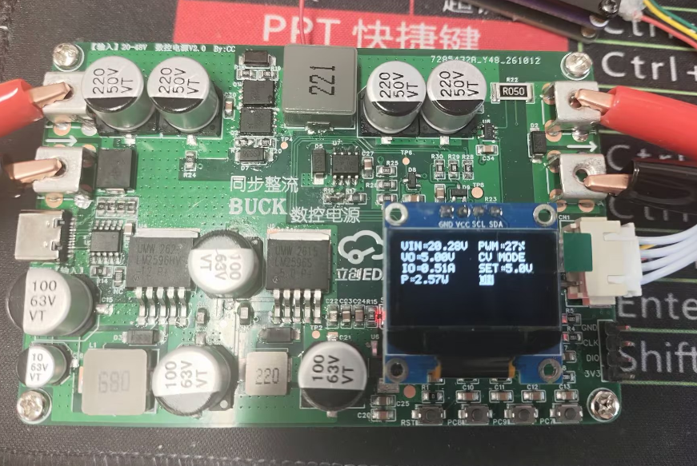
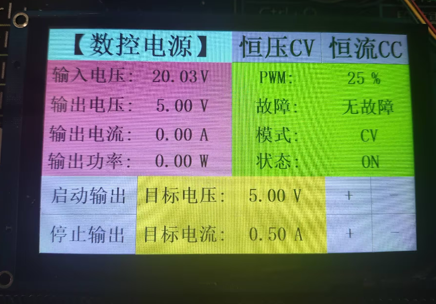

# 基于 STM32F401RCT6 的同步整流 BUCK 数控电源

## 1. 项目简介

本项目是一套以 **STM32F401RCT6** 为主控制器的同步整流 BUCK 降压数控电源。硬件主要由电源输入、辅助电源、同步 BUCK 功率变换、输出反馈采样和人机交互等部分组成。

根据原理图，系统设计的主要参数如下：

| 项目 | 原理图标注 |
|---|---|
| 主控芯片 | STM32F401RCT6 |
| 输入方式 | USB Type-C PD 输入 / 外部直流输入 |
| 输入电压范围 | 外部输入 20～48V；Type-C PD 诱骗 20V |
| 输出电压范围 | 5～15V |
| 功率变换拓扑 | 同步整流 BUCK 降压 |
| 栅极驱动芯片 | IR2104 |
| 电流检测芯片 | INA180A2 |
| 辅助电源 | 12V、5V、3.3V |
| 人机交互 | OLED、按键及串口屏接口 |

## 2. 系统总体结构

系统可以分为以下几个功能模块：

1. **电源输入模块**：通过 Type-C PD 或外部直流电源为系统供电。
2. **辅助电源模块**：将输入电压转换为 12V、5V 和 3.3V，为驱动电路及控制电路供电。
3. **同步 BUCK 功率变换模块**：由 IR2104 驱动上下桥臂 MOSFET，通过 PWM 调节降压输出。
4. **反馈采样模块**：采集输入电压、输出电压和输出电流，并将模拟信号送入 STM32 ADC。
5. **主控与人机交互模块**：STM32 负责采样、控制和状态管理，OLED、按键及串口屏接口用于参数设置和状态显示。

系统的预期控制流程为：

```text
输入电源
   │
   ├── 辅助电源：12V / 5V / 3.3V
   │
   ▼
同步 BUCK 功率级
   │
   ▼
直流输出
   │
   ├── 输出电压采样 ──┐
   ├── 输出电流采样 ──┤
   └── 输入电压采样 ──┤
                      ▼
                 STM32F401RCT6
                      │
                 PWM / 使能控制
                      │
                      └──── 返回功率驱动级
```

上述闭环控制流程需要由 STM32 固件实现；原理图本身只能说明硬件提供了相应的控制和反馈接口，不能单独证明软件已经实现恒压、恒流或完整保护功能。

## 3. 主控电路（MCU）

主控芯片为 **STM32F401RCT6**，负责系统控制、ADC 数据采集、PWM 输出以及人机交互。

### 3.1 时钟电路

原理图使用 8MHz 外部高速晶振，连接 MCU 的 OSC_IN 和 OSC_OUT 引脚，C8、C9 为 22pF 负载电容。系统可通过 STM32 时钟树配置及 PLL 倍频获得所需的系统时钟。

### 3.2 复位与启动配置

- R2（10kΩ）用于将 NRST 上拉至 3.3V。
- SW1 为复位按键，按下后使 MCU 复位。
- C10（100nF）用于复位电路的滤波。
- R3（10kΩ）将 BOOT0 下拉，正常情况下从用户 Flash 启动。

### 3.3 控制与采样接口

原理图中标注的主要信号如下：

| 信号名称 | MCU 端口标注 | 功能 |
|---|---|---|
| TIM1_PWM | PA8 | PWM 控制信号 |
| DC_EN | PB9 | 功率驱动使能控制信号 |
| ADC_IOUT | PC0 | 输出电流采样 |
| ADC_VIN | PC1 | 输入电压采样 |
| ADC_VOUT | PC2 | 输出电压采样 |
| OLED_SDA | PB7 | OLED I²C 数据 |
| OLED_SCL | PB6 | OLED I²C 时钟 |
| KEY1、KEY2、KEY3 | PC7、PC8、PC9 | 用户按键 |
| TX、RX | PA9、PA10 | 串口屏 |
| SWDIO | PA13 | SWD 调试数据 |
| SWCLK | PA14 | SWD 调试时钟 |

实际固件中使用的 GPIO 复用功能、定时器通道、ADC 通道和引脚映射，应以 MCU 数据手册及工程配置为准。

### 3.4 显示与通信接口

原理图包含 OLED 接口、SWD 下载调试接口和串口屏接口。OLED 通过 SDA、SCL 与 MCU 通信；串口屏接口提供 TX、RX、供电和地线，可用于扩展人机交互。

## 4. 电源输入模块

### 4.1 Type-C PD 输入

Type-C 输入部分使用 CH224A 进行 USB PD 协议诱骗/电压档位请求，原理图标注为 20V 输入。实际能否获得 20V，取决于 PD 电源适配器支持的档位、线缆能力以及协议协商结果。

### 4.2 外部直流输入

原理图还提供外部 20～48V 直流输入接口。输入端配置了瞬态抑制器件 D1（CJSMCJ48CA）等保护元件，用于应对一定范围内的输入瞬态干扰。

使用外部电源时，应确认电源极性、实际电压范围、连接器额定电流和保护器件参数。不得将超过器件额定值的电压直接接入电路。

### 4.3 输出接口

原理图通过输出连接器引出 VOUT 和 PGND。D2（SS36）位于输出相关网络中，其具体保护作用应结合二极管方向、网络连接和 PCB 实际走线确认，不应仅凭器件名称认定其具备完整的反接或反灌保护能力。

## 5. 辅助电源模块

辅助电源为控制电路和驱动电路提供不同电压等级。

| 电源级 | 主要器件 | 原理图标注输出 | 主要用途 |
|---|---|---|---|
| 第一级 | LM2596HVS-12 | +12V / 3A | 为驱动等电路提供 12V |
| 第二级 | LM2596S-5.0 | +5V / 3A | 提供 5V 电源 |
| 第三级 | AMS1117-3.3 | 3.3V，标注 1A | 为 MCU 等低压电路供电 |

电源转换路径为：

```text
输入直流电源
     │
     ▼
LM2596HVS-12
     │ +12V
     ▼
LM2596S-5.0
     │ +5V
     ▼
AMS1117-3.3
     │ +3.3V
     ▼
STM32 等控制电路
```

各级电路中的电感、肖特基二极管和输入/输出电容分别参与开关电源的储能、续流和滤波。实际可用输出电流还受输入电压、散热、器件封装、PCB 铜箔和工作条件限制，不能仅依据原理图中的标注值判断。

## 6. 同步整流 BUCK 功率变换模块

这是系统的核心功率级，主要由 IR2104、上下桥臂 MOSFET、输出电感和滤波电容构成。

### 6.1 主要器件

| 器件 | 作用 |
|---|---|
| U7：IR2104 | 高、低侧 MOSFET 栅极驱动 |
| Q1 | 上桥臂 MOSFET |
| Q2 | 下桥臂 MOSFET |
| L3 | 功率储能电感 |
| C31、C32、C33 | 输出滤波电容 |
| R18、R20 | MOSFET 栅极串联电阻 |
| R19、R21 | MOSFET 栅极下拉电阻 |
| C27 及自举二极管 | 为高侧驱动提供自举供电 |

### 6.2 工作原理

同步 BUCK 通过控制上、下桥臂 MOSFET 交替工作，将较高的直流输入电压转换为较低的直流输出电压。

**状态一：上桥臂 Q1 导通**

输入电源经 Q1 向电感 L3 和负载供能，电感电流上升，电感储存能量。

**状态二：上桥臂 Q1 关断、下桥臂 Q2 导通**

电感电流通过下桥臂 Q2 形成续流通路，继续向负载供电，电感电流逐渐下降。

电路持续重复上述过程，再由电感和输出电容共同滤波，得到较平稳的直流输出。

在理想连续电感电流模式下，BUCK 的基本关系为：

\[
V_{OUT}=D\cdot V_{IN}
\]

其中：
- \(V_{OUT}\)：输出电压；
- \(V_{IN}\)：输入电压；
- \(D\)：上桥臂 PWM 的有效占空比。

例如，输入电压为 24V、理想占空比为 50% 时，理论输出电压约为 12V。实际输出会受到 MOSFET 导通压降、电感电阻、开关损耗和负载等因素影响。

### 6.3 IR2104 驱动说明

IR2104 是高低侧栅极驱动器，不是直接进行功率变换的器件。其主要引脚功能为：

| 引脚 | 功能 |
|---|---|
| VCC | 低侧驱动供电 |
| IN | 驱动逻辑输入 |
| SD | 关断控制输入 |
| HO | 高侧栅极驱动输出 |
| LO | 低侧栅极驱动输出 |
| VB | 高侧浮动电源 |
| VS | 高侧浮动参考点 |
| COM | 驱动地 |

C27 与自举二极管构成高侧驱动的自举供电网络。高侧驱动需要在合适的开关状态下完成自举电容充电，因此还应检查最大占空比、低侧导通时间和启动过程是否满足 IR2104 数据手册要求。

上下桥臂必须避免同时导通，否则会产生直通电流，可能损坏 MOSFET。应根据 IR2104 的逻辑和时序要求检查 PWM 输入、关断控制、死区以及驱动波形，不能只依据软件中的 PWM 占空比判断驱动安全。

## 7. 电压与电流反馈采样模块

反馈页设计了输入电压、输出电压和输出电流三路采样信号，分别送入 STM32 的 ADC。

### 7.1 输入电压采样

主要器件：
- R25：150kΩ；
- R26：10kΩ；
- R27：100Ω；
- D8：BAT54S；
- C35：100nF。

输入电压经 R25、R26 分压后形成 ADC_VIN。理想分压关系为：

\[
V_{ADC\_VIN}=V_{IN}\cdot\frac{10k}{150k+10k}
=\frac{V_{IN}}{16}
\]

因此：

\[
V_{IN}=16\cdot V_{ADC\_VIN}
\]

按原理图标注，输入 20～48V 时，ADC 端约为 1.25～3.00V。

### 7.2 输出电压采样

主要器件：
- R28：49.9kΩ；
- R29：10kΩ；
- R30：100Ω；
- D9：BAT54S；
- C36：100nF。

理想分压关系为：

\[
V_{ADC\_VOUT}=V_{OUT}\cdot\frac{10k}{49.9k+10k}
\]

因此：

\[
V_{OUT}=V_{ADC\_VOUT}\cdot5.99
\]

按原理图标注，输出 5～15V 时，ADC 端约为 0.835～2.504V。

### 7.3 输出电流采样

电流采样使用 R22（50mΩ）作为分流电阻，U8（INA180A2）作为电流检测放大器。

电流流过采样电阻时产生压降：

\[
V_{SHUNT}=I_{OUT}\cdot R_{SHUNT}
\]

其中：

\[
R_{SHUNT}=0.05\Omega
\]

INA180A2 的标称增益为 50，因此在输入极性和接线方向正确、器件处于线性工作范围内时：

\[
V_{ADC\_IOUT}=I_{OUT}\cdot0.05\cdot50
=2.5I_{OUT}
\]

由此可得：

\[
I_{OUT}=\frac{V_{ADC\_IOUT}}{2.5}
\]

例如，输出电流为 1A 时，采样电阻压降约为 50mV，放大器输出约为 2.5V。

需要注意：
- 应核对 INA180A2 的 IN+、IN- 与采样电阻两端的实际连接极性。
- 应确认 ADC 输入范围不会超过 MCU 的允许范围。
- 采样电阻需要校核额定功率、精度、温漂和 PCB 大电流走线。
- 电流采样的实际零点、增益误差和偏置需要通过实测校准。

## 8. 地线与 PCB 布局

原理图中使用了 PGND、DGND 和 AGND 等不同地网络，分别服务于功率回路、数字控制电路和模拟采样电路。

- **PGND**：功率开关和负载电流的主要回流路径。
- **DGND**：STM32 和数字接口的参考地。
- **AGND**：模拟采样电路的参考地。

区分地网络的目的是控制大电流回流路径，降低开关噪声对 ADC 采样的影响。但不同地网络是否电气隔离，必须依据实际网络连接判断。原理图中的 0Ω 电阻连接属于电气连接方式，不等于隔离。

PCB 布局时建议重点关注：

1. 缩小输入电容、上下桥臂 MOSFET 和功率回路构成的高频电流环路。
2. MOSFET、驱动芯片和栅极电阻尽量靠近布置，缩短栅极驱动回路。
3. 电感、输出电容和负载回流路径应合理规划，避免大电流经过敏感采样区域。
4. 电流采样电阻采用尽可能对称、独立的采样引线，避免直接从大电流铜箔随意取样。
5. ADC 分压和电流检测信号远离 SW 等高 dv/dt、高 di/dt 节点。
6. 按照实际电压、爬电距离、铜箔宽度和器件散热要求进行设计。

## 9. 控制软件的基本思路

软件思路：

1. 初始化系统时钟、GPIO、ADC、定时器 PWM、显示和按键。
2. 读取输入电压、输出电压和输出电流。
3. 对 ADC 数据进行必要的滤波和标定。
4. 获取用户设定的目标输出电压及工作参数。
5. 根据目标值和反馈值计算控制误差。
6. 通过控制算法调整 PWM 占空比。
7. 对输入欠压、输入过压、输出过压、输出过流和过温等异常进行处理。
8. 在 OLED 或串口屏上显示设定值、测量值和运行状态。

恒压 PI 控制的一般形式为：

\[
e(k)=V_{SET}-V_{OUT}(k)
\]

\[
u(k)=K_Pe(k)+K_I\sum_{i=0}^{k}e(i)
\]

其中 \(u(k)\) 用于调整 PWM 控制量。实际实现时还需要加入占空比限幅、积分抗饱和、软启动和故障关断等措施。

> 注意：以上是可采用的软件控制思路，并非由原理图直接证明已经实现的功能。恒流控制、恒压恒流切换、过流保护、短路保护和过温保护等功能，需要在固件和硬件中分别落实并验证。

## 10. 上电调试建议

建议采用由低风险到高风险的顺序进行调试：

1. **断电检查**：检查电源输入极性、焊接质量、MOSFET 引脚方向、二极管方向以及电源与地之间是否存在异常短路。
2. **辅助电源测试**：暂不安装或不使能功率级，先确认 12V、5V、3.3V 电源是否正常。
3. **MCU 测试**：确认 STM32 能正常下载程序、复位运行，并检查 OLED、按键和串口通信。
4. **驱动测试**：在功率级安全隔离或采用适当测试条件下，检查 IR2104 的 VCC、VB、VS、HO、LO 和关断逻辑。
5. **低压限流测试**：使用可调、限流的直流电源，在确认功率器件额定值和接线无误后进行低风险测试。
6. **反馈校准**：分别测量输入电压、输出电压和输出电流，与 ADC 换算值进行比较并校准。
7. **动态测试**：逐步改变输入电压和负载，观察输出稳定性、开关波形、器件温升和保护动作。

功率级涉及较高电压和较大电流。调试时应使用合适的限流电源、差分探头或正确的测量方法，避免示波器接地夹造成短路。未确认驱动时序和保护措施前，不要直接满压、满载运行。

## 11. 可以进一步确认的设计参数

当前原理图没有完整给出以下信息，后续设计或文档中应补充：

- BUCK 开关频率及定时器 PWM 配置；
- 最大输出电流和额定输出功率；
- MOSFET 的完整型号、导通电阻、栅极电荷及热设计；
- L3 的电感量、饱和电流和额定电流；
- 输出电容的耐压、容量、纹波电流和 ESR；
- IR2104 的驱动电源、自举电容取值及实际驱动时序；
- 电压、电流采样的校准系数和滤波参数；
- 恒压/恒流控制策略及 PI 参数；
- 输入欠压、输入过压、输出过压、过流、短路和过温保护阈值；
- 目标效率、纹波、动态响应和温升等实测指标。

## 12. 实物图




## 13. 总结

本设计以 STM32F401RCT6 为控制核心，通过 IR2104 驱动上下桥臂 MOSFET 构成同步整流 BUCK 降压功率级，实现直流输入到可调直流输出的电能变换。辅助电源模块为控制和驱动电路提供多路工作电压；反馈采样模块通过电阻分压和 INA180A2 电流检测放大器获取输入电压、输出电压及输出电流信息，为后续数字闭环控制提供数据基础。

整个系统的关键在于功率变换、驱动时序、反馈采样和控制算法之间的协调。完成原理图设计后，还需要结合 PCB 布局、固件开发和分阶段实测，验证输出范围、带载能力、稳定性、效率及保护功能。
